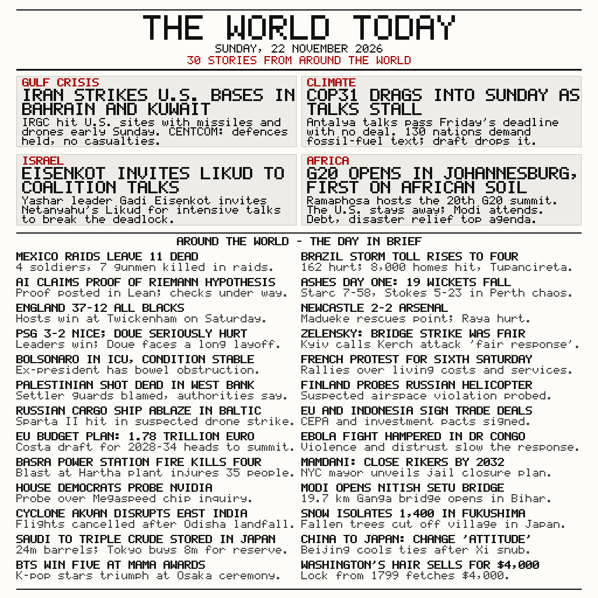

# The World Today — Sunday, 22 November 2026

[](https://make.fun/c/news-image-20261122)
[](https://make.fun/c/news-image-20261122)
[](https://make.fun/c/news-image-20261122)

One image summing up the world's news of Sunday 22 November 2026, built
for the [make.fun](https://make.fun) bounty
[news-image-20261122](https://make.fun/c/news-image-20261122).



## What it shows

Four lead stories — Iran's early-Sunday strikes on U.S. bases in Bahrain
and Kuwait, COP31 dragging into Sunday with no deal, Eisenkot inviting
Likud to coalition talks, and the G20 opening in Johannesburg — plus 26
compact items from around the world: the Mexico raids, the Brazil storm,
an AI claim on the Riemann hypothesis, the Ashes opener in Perth,
Newcastle 2–2 Arsenal, and more. 30 stories in one page.

## How it works

`main.py` (Python 3.13, standard library only) draws the whole front
page itself — masthead, leads and compact grid — with a hand-built 5x7
bitmap font and a small PNG encoder, and writes it to
`/output/entry.png`. No network, no fonts, no dependencies. Run it twice
and the bytes are identical:

```sh
MAKEFUN_OUTPUT_DIR=out python3 main.py
```

## License

MIT — see [LICENSE](LICENSE).
